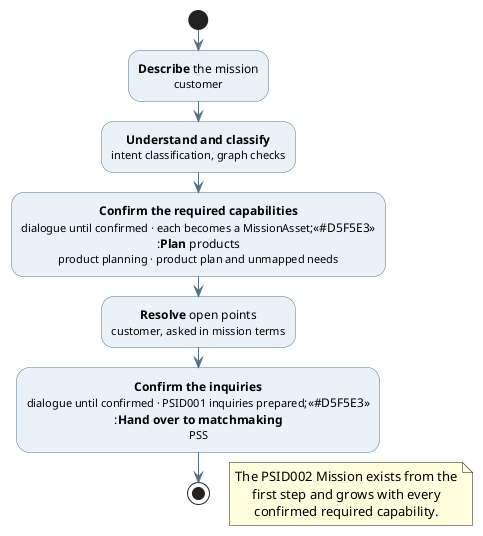

# AI-Assisted Capability Extraction for Mission-Based Product Inquiry

* ID: ADR049
* Status: :proposed:
* Deciders: Alexander Brehmer
* Consulted: Wolfgang Robben, Christian Grubert, Sebastian Stark, Manuel Vigelius
* Date: 2026-11-25
* Version: 0.1
* Category: Architecture

Technical Story: AI mission companion for the mission-based product inquiry of the extended user journeys (PSI-CST)

## Context and Problem Statement

In the mission-based product inquiry of the extended user journeys (PSI-CST), the customer describes a mission (PSID002) and the PSS creates product inquiries (PSID001) for it.
The journey names an AI-based mission companion and a knowledge graph as aids for this step, but does not describe them.
As ADR040 notes, customers are rarely experts in satellite products.

Customers describe missions in their own words:

> "A forest fire is spreading towards the town. We need to know where it is and where it's heading, and our crews must be able to talk when the mobile network goes down."

An inquiry, however, needs product types, a place, a service period and characteristics with priorities and preferred, minimum or maximum values.
Today only the customer or an expert can make this translation.
It is hard because one mission often needs SatCom, Earth observation and derived intelligence at once, the services depend on each other, and the mission changes over time.

Product types exist mainly for SatCom, and ADR029 dropped the idea of attaching capabilities to products.
The knowledge about customer needs therefore has to live on its own, independent of any product catalog.

How should PSI help a customer turn a mission description into reviewed requirements and PSI inquiries?

## Decision Drivers

* The customer stays in control: nothing is added or submitted without confirmation.
* The result is standard PSID002 and PSID001 content; the steps after the inquiry stay as they are.
* The solution does not depend on one catalog or PSS.
* It covers all service categories and missions that change over time.
* Its quality is shown by evaluation.
* The knowledge is open and based on public sources.
* The AI provider can be replaced, including by a self-hosted model.

## Considered Options

* Option 1: LLM directly over the product catalog. Bound to one catalog, unchecked, and cannot cover needs without product types.
* Option 2: Mission templates only. Cannot handle free-text missions or combinations no template foresaw.
* Option 3: AI companion based on an engineering inventory of capabilities and functions. Describes how services are built, not what customers need.
* Option 4: Capability knowledge graph with an AI mission companion
* Option 5: Capability vocabulary inside the product catalog. Dropped by ADR029, and cannot express needs without a product type.

## Decision Outcome

Chosen option: "Option 4: Capability knowledge graph with an AI mission companion", because it is the only option that covers all service categories without depending on a catalog, keeps the customer in control and can be tested step by step.

### Components

| Component | Does | Decides |
|---|---|---|
| Capability knowledge graph | Describes what customers can need from satellite services | Valid capabilities, parameters, dependencies and scenarios |
| AI mission companion | Runs the conversation around each step and explains the results | Nothing alone: it proposes, the customer confirms |
| Product planning | Works out which product types the PSS would need to serve the confirmed required capabilities | The product plan, and what stays unmapped |

Table: Components of AI-assisted capability extraction. {#tbl:adr049-components}

The **capability knowledge graph** describes customer needs, not products:

* *capabilities*: kinds of need in the customer's terms, independent of technology, under three domains (communicate, observe the Earth, derive intelligence);
* *capability parameters*: properties of a capability, such as place or delivery time; they are also the questions to ask;
* dependencies between capabilities (`requires`), which become MissionAsset relationships;
* *scenarios*: typical missions with phases, usable as templates;
* the public *sources* behind each entry.

Scenarios give the AI a frame for situations described in everyday words, suggest what the customer has not yet mentioned and what typically comes next, and serve as templates and test cases.
The graph is open, stored in the Open Knowledge Format (OKF), and every change is validated and reviewed.

### Principles

* **The mission is the context.** A PSID002 Mission is created as soon as the customer starts and grows with every confirmed *required capability*: a capability of the graph with this mission's parameter values, e.g. group voice for twelve crews in the fire area. A mission usually has several, and the same capability can be required more than once. Each required capability is held by a MissionAsset, which needs no product type when it is created.
* **The AI proposes, the graph checks, the customer decides.** The AI reads the customer's text, recognises the scenario and proposes capabilities and values. The graph decides what a rule can decide: which concepts are valid, which dependencies follow, which parameters are missing and which phase comes next.
* **Two confirmations.** The customer confirms the required capabilities before products are planned and the PSI objects before they are sent.
* **Nothing is hidden.** A required capability that no product type serves stays visible as unmapped and is never replaced by a different service. A failed AI call never changes what the customer has confirmed.
* **AI output never goes to the PSS directly.** Mission and inquiries are built by ordinary code from confirmed content and validated against PSID001 and PSID002.
* **Mission terms, not product terms.** Questions are asked in terms of the mission; product types appear in the final review and on request.

### Workflow

1. **Describe.** The customer describes the mission in free text or starts from a scenario. The Mission is created.
2. **Understand.** The companion extracts requirements, place, time and stated values.
3. **Classify.** Intent classification assigns the requirements to capabilities and recognises the scenario; the graph adds dependencies and finds missing parameters (section 4).
4. **Confirm.** The customer answers the open questions and confirms the required capabilities. Each becomes a MissionAsset, and dependencies become asset relationships.
5. **Plan.** Product planning works out which product types of the selected PSS serve the confirmed required capabilities, and what stays unmapped.
6. **Resolve.** The companion turns open choices and characteristics the product types still need into questions about the mission.
7. **Build and confirm.** The assets are completed and the CustomerInquiry requests prepared, recording which inquiry belongs to which assets. The customer reviews them and confirms before they are sent.
8. **Hand over.** The confirmed inquiries go to the PSS's matchmaking, where this workflow ends.

Steps 2 to 4 and steps 5 to 7 are each a dialogue: the companion proposes and asks, the customer corrects, until the customer confirms. If planning shows that a required capability cannot be served as asked, the customer can go back and change it.
The Mission stays open after the inquiries are sent and can be extended later with further required capabilities.

{#fig:adr049-workflow}

### Capability extraction (intent classification)

Capability extraction is the core of this decision: turning the customer's words into confirmed required capabilities.
Its central step is *intent classification*, which assigns each customer requirement to the capabilities of the graph.

**Pipeline.**
The pipeline runs within workflow steps 2 to 4. Each customer turn runs through five steps. The AI handles language, the graph handles structure, and a mission state holds what the customer has confirmed:

1. **Requirement extraction** (AI): the text is split into individual requirements, each linked to the words it came from.
2. **Intent classification** (AI, constrained by the graph): each requirement is assigned to candidate capabilities with a score, and the scenario is recognised. Several capabilities can apply, and a broader parent capability can stand in when the intent is vague. The output is restricted to capability identifiers that exist in the graph.
3. **Graph reasoning** (graph only): dependencies, missing parameters, constraints, the next question and the next mission phase are derived by rules (see below).
4. **Parameter extraction** (AI, checked by the graph): values are read from the text and validated against the type, unit and allowed values of each capability parameter.
5. **Dialogue** (AI): proposals and the next question are phrased for the customer, whose confirmations and corrections update the mission state.

The AI does not change the mission state itself. Each turn, it receives the current state and the new message and returns a structured proposal, which is validated against the graph before it is applied.
Every proposed capability can be traced to the customer's words and, where the graph added it, to the rule that did so.

**How the graph reaches the AI.**
The classification method is not decided here. These patterns are compared in the evaluation:

* **Catalog in the prompt** (baseline): the capabilities with their labels, definitions and distinctions are given to the AI, which answers in a structured format limited to graph identifiers. This suits a smaller graph.
* **Knowledge-graph retrieval (GraphRAG):** an embedding-based semantic search finds the capabilities whose titles, labels, definitions or example intents resemble the requirement. The graph then adds what plain retrieval would miss: similar capabilities to tell apart, the broader parent and what the matches depend on. The AI decides with this context in view.
* **Hierarchical classification:** the requirement is classified from the top of the capability tree downwards, with a small choice at each level. System-1 decision models such as Jev fit this well and return probabilities, which the question selection and the fallback to a parent capability use.
* **Graph as tools:** the AI queries the graph through defined functions, such as searching capabilities, reading a capability, its children, dependencies or missing parameters, and assembles the result itself. The OKF bundle is already navigable this way. This is the most flexible pattern and the hardest to test.

Scores matter as well as labels: whether to ask or to decide depends on them, so their calibration is part of the evaluation.

**What the graph decides.**
In step 3, the graph turns the AI's proposals into checked, complete required capabilities:

* *Dependencies:* each capability lists what it `requires`; the graph adds what is missing, e.g. observations for a damage assessment.
* *Missing parameters:* each capability lists the parameters that matter for it; those still open become questions.
* *Questions in the right order:* the companion asks first the question that best separates the remaining candidates (the highest expected information gain over the capability tree), and stops when the answer would no longer change the result.
* *Vague intents:* if no specific capability is clear but its parent is, the parent is proposed and the companion narrows it down.
* *Constraints along dependencies:* requirements pass to the prerequisites in the order of the `requires` graph. An analysis needed within six hours over an area means imagery of that place, delivered sooner; the derived values are marked as such and can be changed by the customer.
* *Next phase:* the scenario suggests what typically follows, e.g. communications for field teams after the situation has been assessed.

### Product planning

Product planning is outlined here and decided in a follow-up record.
It is not a one-to-one lookup: one required capability can need several products (a private network needs a VPN and terminals), one product can serve several capabilities (one VPN carries the crews' data and the situational picture), products must fit together (a terminal must match the frequency band and access network of the service), and values add up when products are shared.
Planning therefore has two parts:

* **Coverage:** which product types can serve which capability, and how far. This is largely independent of a mission and can be prepared and reviewed for PSI's reference product types.
* **Composition:** which set of product types serves this mission, respecting dependencies and compatibility, with the values the shared products need and the needs that stay unmapped.

For the field phase of the wildfire example, a plan could be: one Basic IP VPN carrying both the crews' data and the situational picture, with their bandwidths added; a satellite terminal per site, matching the VPN's band and access network; automatic failover unmapped, because the product type has no such characteristic.

Each planned product becomes an inquired product: its product type is the `targetProductSchema`; capability parameters become the characteristics of that type through a small, reviewed lookup per product type; `place`, `servicePeriod` and precedence are copied. Each plan records the schema versions it was made against and is checked again when they change.

Candidate methods, compared in one evaluation on the same missions:

* **Plain LLM call** (baseline): the AI receives the required capabilities and the product schemas and proposes the whole plan.
* **System-1 decision models** such as Jev, or **reviewed rules**, for coverage: typed questions such as "does this product type cover this required capability, and with which parameters?".
* **Graph algorithms** for composition: a weighted set cover over capabilities and product types with dependency and compatibility constraints.
* **Combinations** of these, run during mission creation or prepared in advance.

### Deferred decisions

| Topic | Open question | Decided by |
|---|---|---|
| Intent classification | Which of the patterns in section 4 (catalog in the prompt, knowledge-graph retrieval, hierarchical classification, graph as tools) or which combination | Evaluation results |
| Product planning | Which of the candidate methods in section 5, run during mission creation or prepared in advance | Evaluation results |
| Mission-to-inquiry link | PSID001 cannot reference a Mission; whether to extend it, as ADR036 did for inquiry results | Prototype experience |
| Missing product types | Earth observation beyond SAR (ICD Annex III) and derived intelligence; the evaluation uses labelled synthetic types meanwhile | Work on ICD Annex III |
| Capability tags on product types | Whether product types or specifications name the capabilities they serve (e.g. as TMF620 category), so that coverage becomes a lookup | Evaluation evidence |
| Parameter tags on characteristics | Whether product schemas name the capability parameter of each characteristic, so that the characteristic lookup becomes automatic | Evaluation evidence |
| Published product types | How a PSS publishes the product types and schema versions it supports | Journey goal for PSID |
| Relation to matchmaking | Whether an inquiry may name a required capability instead of a product type (`targetProductSchema` is already optional), so that the PSS matching engine (TOD-A01, proposed) takes over part of product planning | Alignment with TOD-A01 |

Table: Decisions deferred to follow-up records. {#tbl:adr049-deferred}

## Compliance

* The TAD gains definitions of *Capability*, *Capability Parameter*, *Required Capability* and *Scenario*.
* Backlog items are created for integrating the companion with the mission management component (ADR040) and for the evaluation.
* The evaluation scores every step separately (requirement extraction, intent classification, parameters, product types and characteristics), so that a failure can be traced to its step, and checks that classification scores are calibrated. Its acceptance tests are complete missions that develop over several turns, up to PSID002 and PSID001 content.
* The test data has a core set labelled by people and a held-out part that is never used to tune prompts or extend the graph. It includes missions with no suitable product type and catalog texts written to mislead the AI. Results on synthetic product types are reported separately from real ones.
* Before a classification or planning method is adopted, limits are agreed for critical errors, latency, cost and the size of graph, catalog and mission it was tested with. The method must stay within them and beat the plain-LLM baseline.
* Follow-up records are filed for the deferred decisions.

### Positive Consequences

* PSS implementations share one vocabulary of customer needs, which catalogs can reference.
* Needs for Earth observation and derived intelligence can be captured before all product types exist, and the gaps become visible.
* Scenarios also serve as mission templates.
* Rule-based steps reduce AI errors and make proposals explainable.

### Negative Consequences

* The graph, product planning and the evaluation data need an owner.
* Until all categories have product types, many required capabilities stay unmapped.
* Synthetic product types can make results look better than they are.

## Security Considerations

* **Confidentiality:** mission descriptions can be sensitive, and the AI processes them. The provider can be self-hosted, mission data never enters the public graph, and rules for retention and logging are set before real missions are used.
* **Integrity:** AI output, graph changes and catalog texts can be wrong or manipulated. Graph changes are reviewed. Product descriptions are given to the AI as information, not as instructions, so their wording cannot steer the result; the AI may only return product types and values that the schema allows, and the customer confirms every result.
* **Availability:** if the AI service fails, the rule-based steps, templates and manual selection still work.

## Implications for the Scope

The AI assistance is optional functionality of a mission management component (ADR040); a PSS does not need it to conform to PSI.
How a PSS matches inquiries and selects offers stays its own concern.
Changes to products already ordered follow the ordering rules (ADR045), not the inquiry.
This record does not change PSID001 or PSID002.

## Example: Wildfire Response

1. The customer enters the wildfire description above, and the companion creates the Mission.
2. Intent classification recognises the scenario *wildfire response* and proposes *detect and monitor wildfires*, *map disaster extent* and *forecast hazards*; the graph adds that all three need observations.
3. The companion asks for the area, the revisit interval, the delivery time and the number of crews. The customer confirms, and the required capabilities, including the observations they depend on, become MissionAssets.
4. For radar imagery, product planning finds the SAR product model where the PSS supports it; the analysis capabilities have no product type yet and stay unmapped.
5. The customer reviews the inquiry and confirms it.
6. Later the customer adds the field phase: *group voice communication* and a *private network between sites* that switches over automatically when a link fails. They are added to the same Mission, and product planning proposes the plan described in section 5; voice has no product type yet. A second inquiry is prepared for them.

## References

* PSI-CST, Extended User Journeys: mission-based product inquiry
* PSI-ICD: PSID001 Customer Inquiry, PSID002 Mission Management; Annex III (in review)
* PSI-TOD: appendix TOD-A01 *Mission-Centric Matchmaking* (proposed)
* ADR029, ADR036, ADR040, ADR045
* [Open Knowledge Format (OKF)](https://github.com/GoogleCloudPlatform/open-knowledge-format/blob/main/SPEC.md)
* [TypeSafe: System One models and Jev](https://typesafe.ai/blog/introducing-system-one-models-and-jev)
