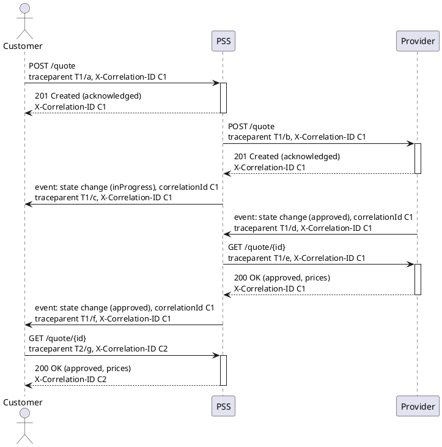

=begin

# Observability

=end

The processing of a request in PSI often spans several systems and goes on after the initial answer to the original sender of the request: a customer sends a request to a PSS, the PSS passes it on to one or more providers or other PSSs, the providers process it later, and the progress and the result come back as events.
E.g. a request for a quote is processed asynchronously: the PSS answers it with `201` once it has validated the request, before it has passed the quote on to the providers and they have processed it.
To follow such processing across the systems, e.g. to find at which system and in which step it failed, or which part of a bundle failed when its processing is split between several providers or PSSs, every request carries two identifiers in HTTP headers, and the systems write both into their log entries:

* The **trace context**, in the header `traceparent`, describes the course of the processing and serves tracing tools, e.g. those based on OpenTelemetry.
  It changes with every request, since it names the step that made the request (see Trace Context), and a tracing tool draws from it which step of which system made the request, when, and how long each step took, and shows the whole processing as a tree.
  It is carried only in the headers of requests.
* The **correlation identifier**, in the header `X-Correlation-ID`, is one value that does not change, the same in every request, answer, event and log entry of the processing; it says what belongs together, not how the processing went.
  The client may set it and gets it back in every answer, also when the request is refused, so that it can refer to it, e.g. when reporting a problem.
  The header is also carried in the body of events, so that it stays with an event that is stored, passed on or read later.

Both identifiers belong to a request, not to a resource.
The identifiers of a request cover everything that its processing causes, until the processing has ended; a later request about the same resource, e.g. the retrieval or the cancellation of a quote, has identifiers of its own.

The TM Forum APIs know the correlation identifier only as the attribute *correlationId* of an event.
PSI also carries it in the header `X-Correlation-ID` of every request and answer; no attribute is added to the TM Forum resources.
Neither header is declared in the PSI OpenAPI definitions, in the same way as the authentication (see Security Considerations): they apply to every PSI API alike, as this chapter describes.

## Processing of a Request

The processing of a request is what the systems do because of it, until it has ended, also after the initial answer.
E.g. the processing of a request for a quote comprises the checks of the PSS, its requests to the providers, their work, the PSS's retrievals of the providers' quotes, the changes of state of the quote until it is approved or rejected, and the events about these changes.
The processing of an event that a system receives is defined in the same way.

* A request that a system makes, or an event that it publishes, in the processing of a request or an event that it received carries the identifiers of that request or event, as the following sections describe.
* Any other request or event starts with new identifiers, e.g. the customer's request for a quote, their later retrieval or cancellation of that quote, or an event about a change that is not part of the processing of any request, such as a change of an offering in the catalog of a provider.

## Trace Context

The header `traceparent` is defined by the [W3C Trace Context](https://www.w3.org/TR/trace-context/) recommendation, e.g.:

```
traceparent: 00-4bf92f3577b34da6a3ce929d0e0e4736-00f067aa0ba902b7-01
```

Besides the version (`00`) and the flags (`01`, sampled: the caller may have recorded the trace), it carries two identifiers:

* The **trace-id** (`4bf92f35…`) identifies the trace.
  The system that starts the trace sets it, and every system passes it on unchanged, so that a tracing tool collects the work of all systems into one trace.
* The **parent-id** (`00f067aa…`) identifies the step at the calling system that made the request; it therefore differs from request to request.

A tracing tool shows a trace as a tree of steps.
A system that records traces records its work as steps, e.g. its handling of a request that it receives, or its sending of a request or an event to another system, each step with an identifier of its own.
For every step, it reports to its tracing tool the trace-id, the identifier of the step, and the identifier of the step under which the step belongs: for the handling of a request that the system receives, the parent-id of that request; for any other step, the step of the same system within which it runs, e.g. the handling of the request that caused it.
From these identifiers, the tracing tool joins the steps of all systems into one tree.
Whether a system records traces, and with which tool, is up to its implementation; PSI requires only that every system passes the trace context on, as the following rules say.
The answer to a request carries no trace context: the calling system knows which of its steps made the request.

* Every PSI request must carry the header `traceparent`.
* A system that receives a request without `traceparent`, or with one that is not valid by the W3C Trace Context recommendation, e.g. with a trace-id of all zeros, must start a new trace, with a new trace-id.
* The requests that a system makes in the processing of a request must carry the trace-id of that request, also after the initial answer, e.g. the PSS's requests to the providers and the requests by which it delivers its events about the quote.
  How a system keeps the trace context until then is up to its implementation.
* In the parent-id of such a request, a system that records traces must put the identifier of the step that makes the request; a system that does not record traces may pass the parent-id that it received on unchanged.
* A system that receives the header `tracestate` must pass it on together with `traceparent`, as the W3C Trace Context recommendation requires.

## Correlation Identifier

The header `X-Correlation-ID` carries the correlation identifier, a string, e.g.:

```
X-Correlation-ID: 019a8f3c-5e21-7b4d-9c0a-3f6e8d2b1a47
```

* Every PSI request and every answer must carry the header `X-Correlation-ID`.
* A system that makes a request in the processing of a request or an event that it received must pass the correlation identifier of that request or event on unchanged.
* For any other request, its sender must set a new value, e.g. the customer for their request for a quote, and again for their later retrieval of the quote.
* A system must accept a correlation identifier of 1 to 128 characters, each a letter, a digit, `.`, `_`, `:` or `-`.
  A system that receives a request without the header, or with any other value, must set a new value for it.
  How a new value within this range is built is up to the system that sets it, e.g. a UUID.
* The server must return the correlation identifier of the request in the header of its answer, also when it refuses the request; when it set a new value, it returns that value.
* A system must keep the correlation identifier of a request for as long as the processing of the request lasts, so that its requests and events after the initial answer carry it, e.g. the PSS keeps the correlation identifier of a request for a quote until the quote is approved or rejected.
* The correlation identifier must not be added to the body of the TM Forum resources.

## Events

An event is delivered to every subscriber in a request of its own (see the Event Management API), it may be passed on, e.g. by the PSS from a provider to the customer, and it may be read long after it was sent.
It therefore carries the correlation identifier in its body, in *correlationId*, as the TM Forum Event structure provides.

* An event that a system publishes in the processing of a request or of another event must carry the correlation identifier of that request or event in *correlationId*.
  E.g. the event by which the PSS passes a product order on to the provider, and the events that the order is in progress and completed, carry the correlation identifier of the request that created the order; the event that the order was cancelled carries the correlation identifier of the request that cancelled the order.
* An event about a change that is not part of the processing of any request must carry a new correlation identifier, set by the system that publishes it, e.g. an event about a change of an offering in the catalog of a provider.
* A system that passes an event on, e.g. the PSS that informs the customer about a change at the provider, must keep its *correlationId*.
* The request by which an event is delivered to a subscriber must carry the two headers as well: its `traceparent` carries the trace-id of the processing that published the event and, in the parent-id, the step that delivers the event, and its `X-Correlation-ID` carries the *correlationId* of the event, i.e. the correlation identifier of the processing that published the event.
  E.g. the PSS's event that a quote is in progress is delivered with the trace-id of the customer's request for the quote and the identifier of the PSS's step that delivers it, not the parent-id of the customer's request, and with the correlation identifier of the customer's request.

## Example

The following sequence shows a quote that the customer requests and the PSS passes on to a provider, and the customer's later retrieval of the quote.
`T1/a` stands for a `traceparent` with the trace-id `T1` and the parent-id `a`; `C1` and `C2` stand for correlation identifiers.
The answer to a request carries the correlation identifier of the request; the delivery of an event is shown as one message, with the headers of the request that delivers it.



{#fig:observability-example}

* Everything that the customer's request for the quote causes carries the trace-id `T1` and the correlation identifier `C1`: the customer's request and the answer to it, the PSS's requests to the provider, the provider's work and its event, and the PSS's events, up to the event that the quote is approved.
  By `C1`, every system relates them to the customer's request, also the events, which are sent long after the initial answer.
  When the PSS splits the quote of a bundle between several providers, all their quotes carry `T1` and `C1`, so that the part that failed can be found.
* The parent-ids `a` to `f` differ: each names the step that made the request, e.g. `b` the step of the PSS that passes the quote on, `d` the step of the provider that reports its quote.
  From the steps that the systems report, the tracing tool draws the trace `T1` as the following tree:

  ```
  a  customer: requests the quote
  +- PSS: handles the request
     +- b  PSS: passes the quote on
     |  +- provider: handles the request
     |     +- d  provider: reports its quote
     |        +- PSS: handles the event
     |           +- e  PSS: retrieves the provider's quote
     |           |  +- provider: handles the request
     |           +- f  PSS: informs the customer (approved)
     +- c  PSS: informs the customer (in progress)
  ```

* The customer's later retrieval is a request of its own: it carries a new trace `T2` and a new correlation identifier `C2`, and relates to the quote only by the identifier of the quote.
  A cancellation of the quote would likewise carry identifiers of its own, and so would the PSS's request that cancels the quote at the provider and the event that the quote was cancelled.

## Uniqueness

The trace context and the correlation identifier only relate requests, events and log entries.
No system uses them to identify a resource or a request, e.g. to recognise a repeated request, or to decide how to process a request.

A system that sets a new identifier should make it unique, e.g. a random trace-id, as the W3C Trace Context recommendation requires, and a UUID as the correlation identifier.
If a value is nevertheless used again, by chance or by a faulty client, the processing is not affected; tracing tools and log searches show unrelated requests together, which the identifiers of the resources, the systems involved and the time tell apart.

## Logging

How a system logs is up to its implementation.
To make use of the identifiers, a system should:

* write into every log entry about the processing of a request or an event the correlation identifier, the trace-id and, if it records traces, the identifier of the current step, so that the log entries of a step can be found from the trace and the reverse;
* log in a structured form, e.g. JSON, with these identifiers in fields of their own, not in the text of the message;
* log, for its requests to other systems, also the identifiers of the TM Forum resources concerned (*id*, *externalId*).
