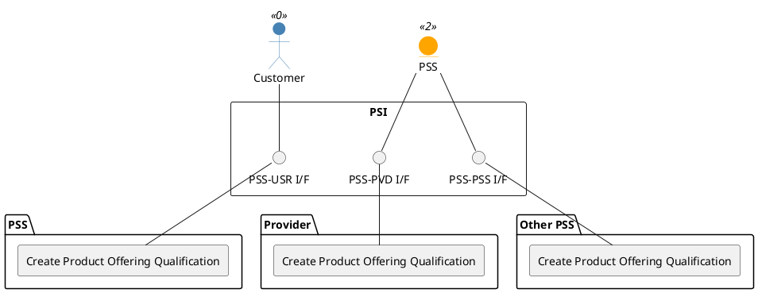

=begin

# TOD-03-05-01-Create_Product_Offering_Qualification

> The heading has to be included in the document including this document.

=end

{#fig:TOD-03-05-01-Create_Product_Offering_Qualification}

**Prerequisites**

The product offerings to qualify are known to the client, from the results of a customer inquiry or from the product catalog.
For a change or the termination of an active product, the product exists in the product inventory of the customer.

**Main operation**

Creates a qualification for one or more product offerings via a standard interface specification.
The customer sends it to the PSS; the PSS answers it itself, e.g. from the data of its product catalog, or sends it on to the provider of each offering, or to another PSS that offers it, and then stores the association between its own qualification and theirs.
A bundle composed by the PSS is sent on per component, each to the provider of that component.

Some properties of a qualification are:

* *checkProductOfferingQualificationItem* - One item per offering to qualify; at least one item is required, each with its *id* within the qualification, its *action* and its *product*.
  Each item names the *productOffering* and, in *product*, the full configuration the customer wants, as characteristics of the product; what is taken over from an inquiry result or a catalog offering, and what the customer completes, is described in [TOD-03-05](#tod-03-05-productofferingqualificationmanagement).
  Its *action* is `add` for a new product, `modify` for a change of an active product and `delete` for its termination. For `modify` and `delete`, *product.id* refers to the active product, and a change sends the complete target configuration.
  `noChange` marks an active product that stays as it is, e.g. a component of a bundle that does not change while another component does.
  A change may set another product offering of the same product specification, e.g. an upgrade, but not another product specification or another provider.
  An item may contain other items, e.g. for the components of a bundle, related by *qualificationItemRelationship*.
  Its *quantity* is the number of units of the offering to qualify.
* *expectedActivationDate* - Per item, the date from which the customer wants the product active: the start for `add`, the date the change takes effect for `modify`, the date of termination for `delete`.
* *requestedQualificationCompletionDate* - The date by which the customer expects the answer.
* *provideAlternative* - Whether the client asks for alternatives for an item that the provider cannot deliver as requested.
* *provideResultReason* - Whether the provider shall give the reasons of a result.
* *relatedParty* - The parties of the qualification with their roles; which parties are named is up to the implementation.
* *externalId* - The identifiers of the qualification at other parties, e.g. the identifier that a PSS gave to the qualification it sends on; whether a PSS uses it is up to its implementation.
* *instantSyncQualification* - As in TM Forum: `true`, or no value, states that the client expects the result in the response, `false` that it expects to follow the qualification.
  The server meets this expectation where it can, but always answers with code `201`, as the server of *instantSyncCheck* may answer either way (see [TOD-05-04-01](#tod-05-04-01-checkproductstock)).

The qualification is always created and kept; the request is answered with:

* Code `201` and the qualification with its identifier.
  If the server can qualify at once, the qualification is already `done`, with the results; if a business validation refuses it at once, it is already `rejected`, with the reason in *terminationError* of the items concerned; if the server cannot process it at all, e.g. because of an internal failure, such as when it cannot read its local product catalog, it is already `terminatedWithError`.
  Otherwise it is in a state that is not final, `acknowledged`, or `inProgress` when the processing has already started, possibly with the results of some items.
  The client reads the state to know which case applies.
* A request that does not conform to the interface specification or to the product schema of an item is answered with `400`; a request that another rule prevents, e.g. a configuration outside the values that the offering allows, with `422`, or with `201` and the qualification `rejected` (see above).
  With `400` and `422` no qualification is created.

An offering that is unknown to the PSS or to the provider is not answered with `404`.
A server that detects such an error before it answers the request answers `422` and creates no qualification, or creates the qualification already `rejected`; a server that detects it only after its `201` answer ends the qualification `rejected`, with the reason in *terminationError* of the items concerned.
A client handles both.
The client follows a qualification that is not yet completed with [TOD-03-05-03](#tod-03-05-03-viewproductofferingqualification) or through the event notifications (see [TOD-01-02](#tod-01-02-eventmanagement)).

**REST Endpoints**

@include [TOD-03-05-01 Create Product Offering Qualification Endpoints](endpoints/TOD-03-05-01-Create_Product_Offering_Qualification-endpoints.md)

**Post Conditions**

* The qualification is created in the system that received it, in a state that is not final or, when the server completed it at once, `done`, `rejected` or `terminatedWithError`.
* A PSS that passed it on to the provider or to the other PSS stores the association of both identifiers.

**Applicable Requirements**

@include [TOD-03-05-01 Create Product Offering Qualification Requirements](requirements/TOD-03-05-01-Create_Product_Offering_Qualification-requirements.md)

**eTOM Reference**

The operation is based on the 1.3.3.1 process identifier from the eTOM.
