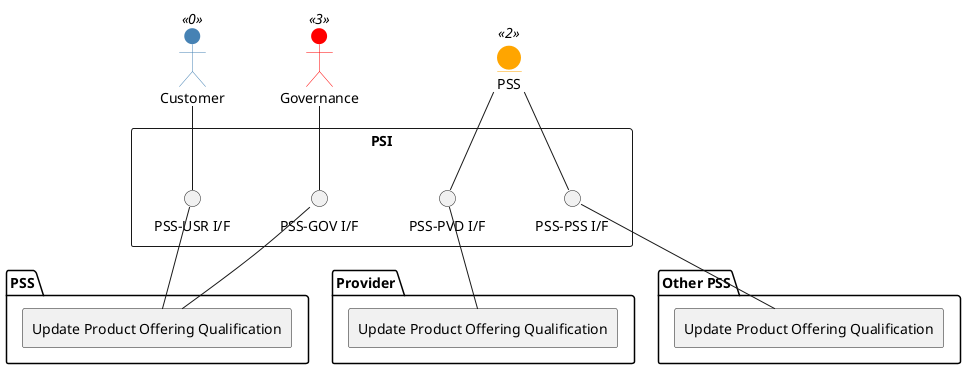

=begin

# TOD-03-05-02-Update_Product_Offering_Qualification

> The heading has to be included in the document including this document.

=end

{#fig:TOD-03-05-02-Update_Product_Offering_Qualification}

**Prerequisites**

The qualification exists, and the client may change it.

**Main operation**

Changes a qualification via a standard interface specification: the attributes that the client set, e.g. a note, the requested completion date, an item, or *state*, to cancel it.
A change contains only attributes of the update schema (*CheckProductOfferingQualification_MVO*), i.e. those that the client sets; the attributes that only the server can modify, e.g. the results, the reasons, the alternatives, the termination error and the dates of the provider, are not part of it.
How a qualification was created, synchronously or not, cannot be changed either.
The server decides which changes it accepts in which state, e.g. a changed configuration of an item while the qualification is `acknowledged`, but not once it is `inProgress`.

A client cancels a qualification it no longer needs by setting its *state* to `cancelled`, from `acknowledged` or `inProgress`; `cancelled` is the only state a client may set.
The PSS cancels the qualifications it created at the providers or at the other PSSs in the same way, on behalf of its customer or for the other components of a bundle whose qualification has failed.
Only the client cancels: a server that cannot or will not complete a qualification ends it `rejected` or `terminatedWithError`.
Cancelling is not removing: the cancelled qualification stays retrievable.

A PSS that, when the qualification was created, passed its items on to providers or to other PSSs also passes a change on to those of them that the change concerns.
Whether the server carries out a change before it answers or later is up to its implementation, also when it passes the change on; e.g. a PSS may pass a cancel on to the provider and wait for its answer, with a long enough timeout, before it answers its client.
A change that the server accepts is answered with:

* Code `200` and the changed qualification, when the server has carried out the change before it answers.
* Code `202`, without a body, when the server carries out the change later; until then the qualification stays unchanged, and the client learns about the outcome by the event notification or by retrieving the qualification.

When a provider or another PSS refuses a change other than a cancel that the PSS passed on, the corresponding item of the qualification at the PSS ends `rejected` if a business rule prevents the change, e.g. with `409` or `422`, or `terminatedWithError` if the change fails otherwise, e.g. with `500` or without an answer.
*terminationError* of the item gives the reason, and the whole qualification ends in the same state (see [TOD-03-05](#tod-03-05-productofferingqualificationmanagement)); a client that still needs a qualification creates a new one.
A system that has received a change should no longer process the qualification as it was before the change, e.g. a provider should not determine results for the previous configuration.

A cancel is handled as follows:

* The qualification at the PSS always ends `cancelled`, also when a provider or another PSS to which the PSS passed the cancel on does not cancel its own qualification.
* How the PSS handles a cancel that fails at a provider or at another PSS is up to its implementation, e.g. it retries it; the qualification left there commits nobody to anything.
* Once the PSS has accepted the cancel, the qualification no longer ends `done`, even when results still arrive.

A change that the server refuses is answered with the following codes:

* Code `409` for a change that the server does not accept in the current state, e.g. any change of a qualification that is already completed (`done`, `rejected`, `cancelled` or `terminatedWithError`), or any change while an earlier change is still being carried out.
* Code `400` for a change that does not conform to the interface specification or to the product schema, e.g. a value of the wrong type or an attribute that only the server can modify.
* Code `422` for a value that a client may not set, e.g. a *state* other than `cancelled`.
* Code `404` for an unknown identifier, `403` for a qualification the client may not change.

**REST Endpoints**

@include [TOD-03-05-02 Update Product Offering Qualification Endpoints](endpoints/TOD-03-05-02-Update_Product_Offering_Qualification-endpoints.md)

**Post Conditions**

* The qualification is changed in the system that received the request; a cancelled qualification is in the state `cancelled`.
* A PSS that, when the qualification was created, passed its items on to providers or to other PSSs has passed the change on to those of them that it concerns; if one of them refused a change other than a cancel, the qualification at the PSS has ended `rejected` or `terminatedWithError`.

**Applicable Requirements**

@include [TOD-03-05-02 Update Product Offering Qualification Requirements](requirements/TOD-03-05-02-Update_Product_Offering_Qualification-requirements.md)

**eTOM Reference**

The operation is based on the 1.3.3.1 process identifier from the eTOM.
