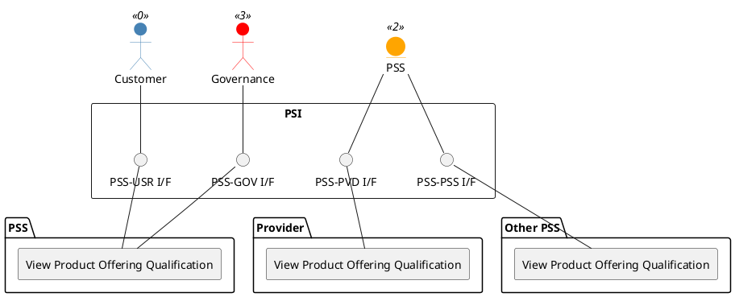

=begin

# TOD-03-05-03-View_Product_Offering_Qualification

> The heading has to be included in the document including this document.

=end

{#fig:TOD-03-05-03-View_Product_Offering_Qualification}

**Prerequisites**

The qualification exists, and the client may read it.

**Main operation**

Retrieves a qualification by its identifier via a standard interface specification, with its state and, once available, its results.
The customer retrieves it from the PSS; the PSS retrieves the qualification it created at the provider or at the other PSS.

The qualification is returned in its current form, with the attributes that the client set and those that the server set.
The parameter *fields* restricts the attributes returned; every attribute of the first level can be selected, a selection inside them only where the server offers it (TMF630 Part 1 v5.0.0, Attribute Selection).

What the qualification carries depends on its state:

* *state* - The state of the qualification and of each item (see [TOD-03-05](#tod-03-05-productofferingqualificationmanagement)).
* *qualificationItemResult* - Per item, `green`, `yellow` or `red`, once the item is completed.
* *qualificationResult* - The result of the whole qualification, following from the results of its items: `red` as soon as any completed item is `red`; once every item is completed, `yellow` if any item is `yellow`, otherwise `green`.
  A `yellow` item does not yet decide the result of the whole, since an item that is still open may end `red`, which makes the whole `red`.
* *alternateProductOfferingProposal* - Per item, alternatives the provider proposes for a `yellow` or `red` item, where the client asked for them (*provideAlternative*).
* *eligibilityResultReason* - Per item, the reasons of its result, whether `green`, `yellow` or `red`, where the client asked for them (*provideResultReason*); the reason why a qualification ended `rejected` or `terminatedWithError` is in *terminationError*.
* *terminationError* - The reason, per item, when the qualification ended `rejected` or `terminatedWithError`; its content is up to the implementation.
* *effectiveQualificationDate* - Set when the qualification ends `done`; a qualification that ends in another state has none.
* *expirationDate* - The date until which the result is valid, where the server states one; without it, the interface does not define how long the result is valid, e.g. the provider may apply rules of its own. After that date the qualification stays `done`; whether a quote or a product order may still refer to it is up to the implementation.

An unknown identifier is answered with `404`, a qualification the client may not read with `403`.

**REST Endpoints**

@include [TOD-03-05-03 View Product Offering Qualification Endpoints](endpoints/TOD-03-05-03-View_Product_Offering_Qualification-endpoints.md)

**Post Conditions**

None; the qualification is not changed.

**Applicable Requirements**

@include [TOD-03-05-03 View Product Offering Qualification Requirements](requirements/TOD-03-05-03-View_Product_Offering_Qualification-requirements.md)

**eTOM Reference**

The operation is based on the 1.3.3.1 process identifier from the eTOM.
