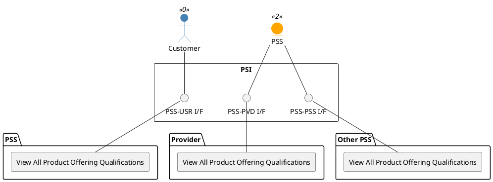

=begin

# TOD-03-05-04-View_All_Product_Offering_Qualifications

> The heading has to be included in the document including this document.

=end

{#fig:TOD-03-05-04-View_All_Product_Offering_Qualifications}

**Prerequisites**

Product Offering Qualifications exist in the PSS or Provider datastore.

**Main operation**

Retrieves the qualifications the client may read via a standard interface specification, page by page with *offset* and *limit* (see [PSI-ICD], High-Level Connection).
A server may also offer filtering by attributes, e.g. by *state* or by *qualificationResult*; as for every list in PSI, filtering is optional (PSI-ICD).
The customer lists their qualifications at the PSS; the PSS lists the qualifications it created at a provider or at another PSS.

The list contains only qualifications the client may read: those it created, unless their owner extended the access (see [PSI-ICD], Authorization and Data Visibility).
When none matches, or the *offset* lies beyond the end of the list, the answer is `200` with an empty list, not an error.
The parameter *fields* restricts the attributes returned for each qualification, as for [TOD-03-05-03](#tod-03-05-03-viewproductofferingqualification).

**REST Endpoints**

@include [TOD-03-05-04 View All Product Offering Qualifications Endpoints](endpoints/TOD-03-05-04-View_All_Product_Offering_Qualifications-endpoints.md)

**Post Conditions**

None; no qualification is changed.

**Applicable Requirements**

@include [TOD-03-05-04 View All Product Offering Qualifications Requirements](requirements/TOD-03-05-04-View_All_Product_Offering_Qualifications-requirements.md)

**eTOM Reference**

The operation is based on the 1.3.3.1 process identifier from the eTOM.
