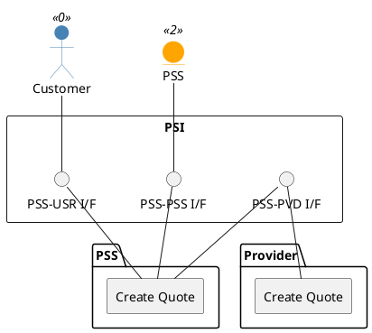

=begin

# TOD-03-06-01-Create_Quote

> The heading has to be included in the document including this document.

=end

{#fig:TOD-03-06-01-Create_Quote}

**Prerequisites**

The quote does not exist in the PSS datastore.
The quoted product offering exists in the PSS catalog or was returned by a customer inquiry; a POQ for it may have been done.

**Main operation**

The customer creates a new quote request in the PSS via a standard interface specification.
The PSS validates it and creates the quote at the provider of each quoted offering via the same endpoint on the provider's system; for a bundle offering or several offerings it decomposes the request as described in [TOD-03-06](#tod-03-06-quotemanagement).
With *instantSyncQuote* set to `true` the priced quote is returned in the response, otherwise the quote is acknowledged and priced afterwards.

Some properties of the quote request are:

* *instantSyncQuote* - Whether the customer expects the priced quote in the response.
* *quoteItem* - List of quote items (mandatory).
* *quoteItem.id* - Identifier of the item within the quote (mandatory).
* *quoteItem.action* - The action to be carried out on the product (mandatory).
  Can be: add, modify, delete, noChange.
* *quoteItem.productOffering* - A reference to the quoted offering.
* *quoteItem.product* - The configured product (mandatory); for modify and delete it refers to the existing product (*quoteItem.product.id*).
* *quoteItem.product.productCharacteristic* - The characteristics of the product.
  They are not mandatory in the schema, because an item with action `delete` needs none; for `add` and `modify` the product has to be fully configured.
* *quoteItem.product.productTerm* - The terms of the product, e.g. contract duration, renewal and charge period; the same for all items.
* *quoteItem.quantity* - The quantity asked for the item.
* *quoteItem.productOfferingQualificationItem* - A reference to the POQ item done before, if any.
* *quoteItem.quoteItemRelationship* - Relations between the items of the quote, e.g. that one item depends on another.
* *quoteItem.quoteItem* - Nested quote items, to reflect the parts of a bundle offering.
* *productOfferingQualification* - A reference to the POQ done before, if any.
* *requestedQuoteCompletionDate* - The date by which the customer wants the quote to be answered.
* *expectedFulfillmentStartDate* - The date on which the customer wishes the quoted items to be delivered.
* *relatedParty* - A list of related parties for the quote (e.g. customer, PSS and provider).
* *channel* - The channel through which the quote was requested.

The provider completes the quote with:

* *quoteItem.quoteItemPrice* - The prices of an item: price, price type (one-time, recurring, usage), recurring charge period and price alterations such as discounts.
* *quoteTotalPrice* - The total prices of the quote, in one currency.
* *validFor* - The period in which the quote can be accepted.
* *expectedQuoteCompletionDate*/*effectiveQuoteCompletionDate* - When the provider expects to answer and when it answered.
* *state*/*quoteItem.state* - The state of the quote and of each item (see [TOD-03-06](#tod-03-06-quotemanagement)).

**REST Endpoints**

@include [TOD-03-06-01 Create Quote Endpoints](endpoints/TOD-03-06-01-Create_Quote-endpoints.md)

**Post Conditions**

The quote is successfully created in the PSS and provider datastores, in the state `approved` (synchronous), `acknowledged` (asynchronous) or `rejected` with the reason.
A request that does not conform to the schema (`400`) or has an error detected at once (`422`) is refused, and nothing is stored.

**Applicable Requirements**

@include [TOD-03-06-01 Create Quote Requirements](requirements/TOD-03-06-01-Create_Quote-requirements.md)

**eTOM Reference**

To be determined.
