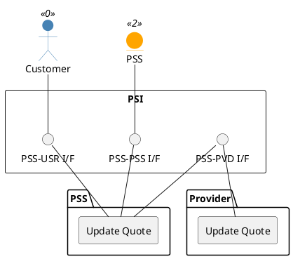

=begin

# TOD-03-06-02-Update_Quote

> The heading has to be included in the document including this document.

=end

{#fig:TOD-03-06-02-Update_Quote}

**Prerequisites**

The quote exists in the PSS and provider datastores and is not in a final state.

**Main operation**

The customer updates an existing quote in the PSS via a standard interface specification.
The PSS then forwards the update to the provider via the same endpoint on the provider's system.
All attributes that TMF648 allows to be modified can be updated: *agreement*, *authorization*, *category*, *channel*, *contactMedium*, *description*, *effectiveQuoteCompletionDate*, *expectedFulfillmentStartDate*, *expectedQuoteCompletionDate*, *externalId*, *instantSyncQuote*, *note*, *productOfferingQualification*, *quoteItem*, *quoteTotalPrice*, *relatedParty*, *requestedQuoteCompletionDate*, *salesOpportunity*, *state*, *validFor* and *version*.

The decision of the customer on a quote in the state `approved` is an update of its state to `accepted` or `refused`.
Withdrawing a quote request before it is priced is an update of its state to `cancelled`; an `approved` quote cannot be cancelled.

Only the customer updates a quote.
The provider does not update quotes in the PSS; the changes on its side (e.g. the prices, *validFor*, the state) reach the PSS by notifications (see [TOD-01-02](#tod-01-02-eventmanagement)).

It is not possible to update quotes in a final state (`accepted`, `refused`, `rejected` or `cancelled`).
A quote whose validity period has ended stays `approved` but can no longer be accepted.

**REST Endpoints**

@include [TOD-03-06-02 Update Quote Endpoints](endpoints/TOD-03-06-02-Update_Quote-endpoints.md)

**Post Conditions**

The quote is successfully updated in the PSS and provider datastores.
An accepted quote can be referenced by a product order (see [TOD-03-02](#tod-03-02-productordermanagement)).

**Applicable Requirements**

@include [TOD-03-06-02 Update Quote Requirements](requirements/TOD-03-06-02-Update_Quote-requirements.md)

**eTOM Reference**

To be determined.
