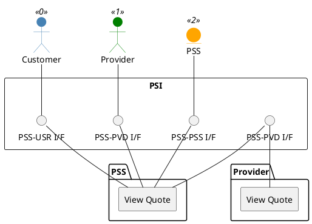

=begin

# TOD-03-06-03-View_Quote

> The heading has to be included in the document including this document.

=end

{#fig:TOD-03-06-03-View_Quote}

**Prerequisites**

The quote exists in the PSS datastore.

**Main operation**

Gets a quote with a specific identifier via a standard interface specification.
The customer can request to view the quote from the PSS, and the PSS can view the quote on the provider's system.
A provider can also view a quote in the PSS if the quote is its own.

Viewing is one way to learn the state a quote has reached and the provider's prices; the other are the notifications of the Event Management API (see [TOD-01-02](#tod-01-02-eventmanagement)).

**REST Endpoints**

@include [TOD-03-06-03 View Quote Endpoints](endpoints/TOD-03-06-03-View_Quote-endpoints.md)

**Post Conditions**

The quote that the client can read is successfully returned to be viewed.

**Applicable Requirements**

@include [TOD-03-06-03 View Quote Requirements](requirements/TOD-03-06-03-View_Quote-requirements.md)

**eTOM Reference**

None
