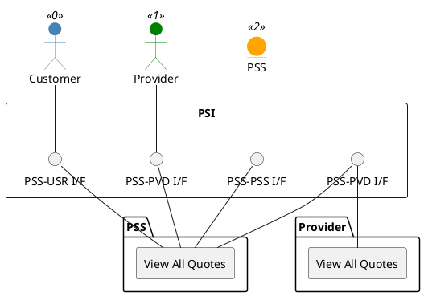

=begin

# TOD-03-06-04-View_All_Quotes

> The heading has to be included in the document including this document.

=end

{#fig:TOD-03-06-04-View_All_Quotes}

**Prerequisites**

Quotes exist in the PSS datastore.

**Main operation**

Gets all quotes of the customer from the PSS via a standard interface specification, in pages (*offset*, *limit*), so that many concurrent quote requests can be monitored.
The PSS can likewise view all of its quotes on the provider's system, and a provider can view all of its own quotes in the PSS.

**REST Endpoints**

@include [TOD-03-06-04 View All Quotes Endpoints](endpoints/TOD-03-06-04-View_All_Quotes-endpoints.md)

**Post Conditions**

All quotes which the client can read are successfully returned to be viewed.

**Applicable Requirements**

@include [TOD-03-06-04 View All Quotes Requirements](requirements/TOD-03-06-04-View_All_Quotes-requirements.md)

**eTOM Reference**

None
