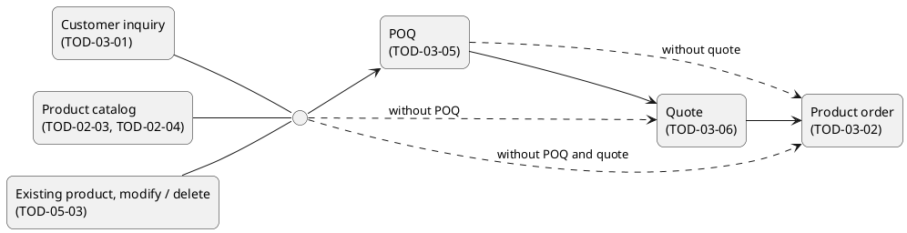
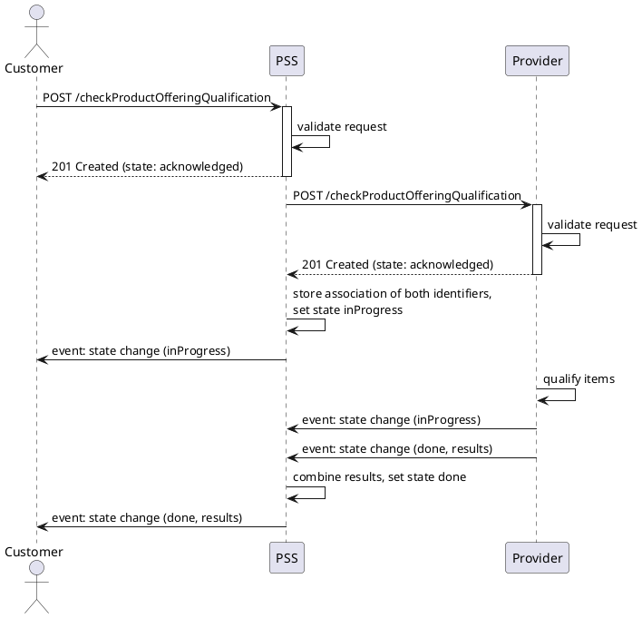
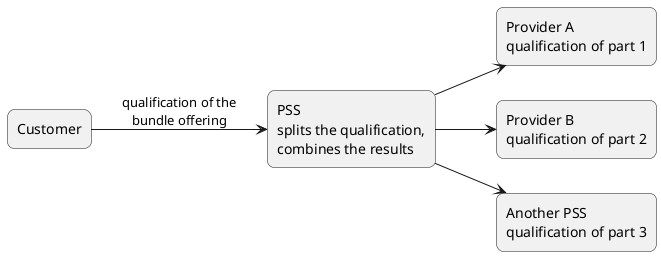
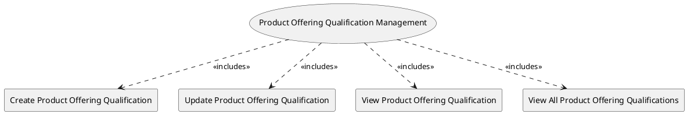

=begin

# TOD-03-05-Product_Offering_Qualification_Management

> The heading has to be included in the document including this document.

=end

The Product Offering Qualification Management task answers the question whether selected product offerings can be delivered as the customer requests them: with this configuration, at this place, from this date.

**Position in the customer journey**

The product offering qualification (POQ) checks product offerings that the customer has selected, either from the results of a customer inquiry (see [TOD-03-01](#tod-03-01-customerinquirymanagement)) or directly from the product catalog (see [TOD-02-04](#tod-02-04-productofferingmanagement)).
It precedes the quote (see TOD-03-06), which fixes the price and the terms, and the product order (see [TOD-03-02](#tod-03-02-productordermanagement)), which books the offering.

The starting point is a customer inquiry, the product catalog (the customer browses the catalog instead of stating requirements) or an active product that is to be changed or terminated. POQ and quote are both optional from the point of view of the interface, each on its own. A product order refers to the qualification and to its items where one was done.

{#fig:TOD-03-05-Product_Offering_Qualification_Journey}

Whether a qualification is required before an order is accepted is not defined by the interface; it may be required by the provider, by the governance of the PSS or by the PSS implementer, and it may depend on the product and on the provider's processes.

Who requests the qualification is not defined by the interface either.
The customer may qualify the offerings of its choice.
The PSS may also qualify offerings automatically, on behalf of its customer, e.g. the offerings that a customer inquiry returned, right after the inquiry.
This is an option under conditions that the PSS defines, e.g. that the configuration of each item can be completed without the customer, from the inquiry result or from the product catalog; whether a PSS offers it, and under which conditions, is left to the PSS implementer.

Every atomic product offering has exactly one provider, which the PSS knows from its product catalog.
The customer selects offerings, not providers: the PSS routes each item, and each component of a bundle, to the provider of its offering, or to another PSS that offers it.
A customer who wants to compare the offerings of several providers qualifies each of them and selects among the results.

A quote or a product order that refers to a qualification keeps the characteristics that the qualification checked; it may add characteristics that the qualification did not set.

**Content of a qualification**

The customer qualifies offerings it selected from the results of a customer inquiry or from the product catalog.
A qualification carries one item per selected offering; it may carry several items, also for the offerings of different providers.
Each item carries the full configuration the customer wants, as characteristics of the product, and the quantity asked for.

**Taking over the inquiry result or the catalog offering**

A qualification does not refer to a configuration prepared earlier, neither to a customer inquiry nor to an earlier query of the catalog; it refers to the catalog only through the product offering and the product specification of each item.
The client therefore either takes over the configuration from the result of a customer inquiry and completes it, or prepares the configuration from the product offerings and product specifications it retrieved from the catalog, so that the qualification carries the full configuration of each item.
The following table shows for each property of the qualification whether it is taken over, from which property, and what the customer completes.

| Qualification                                              | Taken over from the inquiry result                                                                                                               | Taken over from the catalog                                                           | Completed by the customer                                                                                                     |
|------------------------------------------------------------|--------------------------------------------------------------------------------------------------------------------------------------------------|---------------------------------------------------------------------------------------|-------------------------------------------------------------------------------------------------------------------------------|
| *productOffering*                                          | Yes: the offering of the selected result. Property: *inquiredProductRelationship.productOfferingRef*.                                            | Yes: the selected offering. Property: *id* of the offering.                           | Nothing: the customer selected the offering.                                                                                  |
| *product.productSpecification*                             | Yes: the product specification on which the offering is based. Property: *inquiredProductRelationship.productSpecificationRef*.                  | Yes: the product specification on which the offering is based. Property: *productSpecification* of the offering. | Nothing: it follows from the offering.                                                               |
| *product.productCharacteristic*                            | Partially: the characteristics of the product that the result proposes, where it proposes one. Property: *product.productCharacteristic* of the result.   | Partially: a value where the offering or the product specification allows only one or marks one as the default; where they allow a range or several values, the customer chooses. Properties: *prodSpecCharValueUse* of the offering, *productSpecCharacteristic* of the product specification. | Every characteristic the product schema or the product specification requires that is still missing, e.g. a single value where the inquiry asked for a range or for alternatives; within the bounds of the offering. |
| place of delivery: a characteristic of the product, or *product.place* | Yes, as far as the inquiry gives it: the place of the inquired product, which holds for that product only, otherwise a place of the inquiry, which holds for all its inquired products. Properties: *inquiredProduct.place*, *place* of the inquiry. | Partially: the area in which the offering is sold or delivered, where the offering names one. Property: *place* of the offering. | The exact site of delivery, where the inquiry and the offering give only an area or no place at all. |
| *quantity*                                                 | Yes: the quantity of the result for the inquired product. Property: *inquiredProductRelationship.quantity*.                                      | No.                                                                                   | Where the inquiry result gives none.                                                                         |
| *expectedActivationDate*                                   | Yes: the start of the service period of the inquired product, or of the period the result gives instead. Properties: *inquiredProduct.servicePeriod*, *inquiredProductRelationship.servicePeriod*. | No.                                          | Where the inquiry gives none.                                                                                                 |
| nested items of a bundle: *CheckProductOfferingQualificationItem*, *qualificationItemRelationship* | Yes: one item per bundled offering of the selected offering. Property: *bundledProductOffering* of the offering.        | Yes: one item per bundled offering of the offering. Property: *bundledProductOffering* of the offering. | The choice of optional bundled offerings, within the limits of the bundle. Property: *bundledProductOfferingOption* of the offering. |
| *action*, *product.id*                                     | No.                                                                                                                                              | No.                                                                                   | Always: `add` for a new product, `modify` for a change, `delete` for the termination of an active product and `noChange` for a part of an active product that stays as it is; for `modify`, `delete` and `noChange`, the identifier of the active product, from the product inventory. |
| *id* and *note* of an item, *description*, *note*, *channel*, *requestedQualificationCompletionDate*, *provideAlternative*, *provideResultReason*, *provideOnlyAvailable*, *instantSyncQualification* | No.                                                    | No.                                                                                   | As the customer needs them; each item has an *id* within the qualification.                                                   |
| *relatedParty*, *externalId*                               | No.                                                                                                                                              | No.                                                                                   | Up to the implementation: which parties the client names, and whether a PSS gives the identifier of its own qualification in the one it sends on. |

Table: Product Offering Qualification Content Taken Over and Completed. {#tbl:product-offering-qualification-content-taken-over}

* The inquiry result may already carry the full configuration, when the inquiry asked for every characteristic the product schema requires and the result proposes a product with every characteristic the product specification requires; the customer then only adds what the table lists as completed by the customer.
* The characteristics are defined on three levels (see [PSI-ICD], Types and Characteristics): the product type, whose product schema (*targetProductSchema*) lists the characteristics common to all providers; the product specification, which a provider bases on a product type and may extend by characteristics of its own; and the product offering, which is based on a product specification and may narrow the values of its characteristics (*prodSpecCharValueUse*).
  The inquiry states values of the characteristics of a product type; its result returns the offerings in full, with the values they allow (*prodSpecCharValueUse*), together with the product specifications on which they are based, with their characteristics (*productSpecCharacteristic*), and, where the provider proposes one, a configured product (*product*).
  The item of a qualification carries values of the characteristics of the product specification, within the values that the offering allows; where the returned offering leaves a value to the customer, e.g. by allowing a range or several values, the customer sets it in the qualification.
* The place of delivery is a characteristic of the product where its product schema defines one, e.g. the location of the satellite access link trunk (*ipUniAccessLinkTrunk.location* of a Basic Internet Access), and *product.place* is then not used; a product whose schema defines no place, e.g. a satellite terminal, carries it in *product.place*.
* The price of the result (*totalPrice*) is not taken over: a qualification carries no price, the quote fixes it.
* The inquired providers (*inquiredProvider*) are not taken over: each offering has exactly one provider, which the PSS knows from its product catalog.
* The estimated usage (*inquiredProduct.estimatedUsage*), the resources the customer already has (*customerResource*) and the customer profile (*customerProfile*) are not taken over either: the inquiry has already taken them into account in the offerings it returned, and the qualification refers to the customer only by its party (*relatedParty*).
* Where the inquiry result names only a product specification, without an offering, because the product needs a tailored offering (RFQ or ITT, see [TOD-03-01](#tod-03-01-customerinquirymanagement)), there is nothing to qualify yet: a qualification needs a product offering.

**Changes to an active product**

A qualification also checks a change or the termination of an active product from the product inventory (see [TOD-05-03](#tod-05-03-productinventorymanagement)); such a qualification is not preceded by a customer inquiry.
It may have several items; each item that changes or terminates an active product refers to it and carries `action: modify` or `action: delete`, and an item for a part of it that stays as it is carries `action: noChange`.
A change may set other characteristics of the product, within the bounds that its product offering allows, or another product offering of the same product specification, e.g. an upgrade.
It cannot change the product specification or the provider of the product: replacing a product by one of another product specification or another provider is realised as the termination of the active product (`delete`) and a new product of the other offering (`add`).

**Roles and interfaces**

The PSS may answer a qualification itself, e.g. from the data of its product catalog, or pass it on to the provider of the offering, or to another PSS that offers it, by calling their Product Offering Qualification API; which of the two it does is up to its implementation.
When it passes a qualification on, it stores the association between its own qualification and theirs.
The provider, or the other PSS, informs the PSS about the changes of the qualification by notifications via the Event Management API on the topic `qualification` (see [TOD-01-02](#tod-01-02-eventmanagement)).
The PSS informs the customer in the same way about every change of state of its own qualification, so that the customer knows, e.g., when the result is there.
An event carries the whole qualification, so the client does not need to retrieve it (see [TOD-01-02-03](#tod-01-02-03-dispatchevent)).
The requests and events of a qualification carry the trace context and the correlation identifier as described in [PSI-ICD], Observability.

The following sequence shows a qualification that the PSS passes to a provider.
The PSS sets its own qualification `inProgress` as soon as it has passed the items on; it does not wait for the state of the qualification at the provider.

{#fig:TOD-03-05-Product_Offering_Qualification_Sequence}

**Bundles and several providers**

For a bundle offering composed by the PSS from offerings of one or several providers, the PSS qualifies each component with its provider, or with another PSS that offers it, and combines the answers into the result of the bundle.
How the PSS decomposes the qualification and recombines the answers is up to its implementation.

{#fig:TOD-03-05-Product_Offering_Qualification_Decomposition}

* The result of the bundle follows from the results of its parts, as described below.
* When the provider of one part refuses it, i.e. answers with `422` or ends its qualification `rejected`, the qualification of the bundle is refused as well: with `422` when the PSS has not answered the request yet, otherwise it ends `rejected`, with the reason in *terminationError* of that part.
* When a provider does not answer, answers with another error, e.g. `400` or `500`, or ends its qualification `terminatedWithError`, and the PSS gives up, the qualification of the bundle ends `terminatedWithError`, naming the part; whether and how often PSS retries is up to its implementation.
  The PSS may cancel the qualifications of the other parts at their providers.

The same applies when the customer qualifies several offerings in one qualification: each item is passed to the provider of its offering.

**Synchronous and asynchronous processing**

A qualification is always created and kept, and its creation is always answered with code `201`.
The client states with *instantSyncQualification* whether it expects the result in the response (see [TOD-03-05-01](#tod-03-05-01-createproductofferingqualification)).
A server that can qualify at once returns the qualification already `done`, with a result for every item, already `rejected` when a business validation refuses it at once (see Failure handling below), or already `terminatedWithError` when it cannot process it at all, e.g. because of an internal failure, such as when it cannot read its local product catalog.
Otherwise the qualification is returned in a state that is not final, `acknowledged` or, when its processing has already started, `inProgress`, possibly with the results of some items, and the client follows it by retrieving it or through the event notifications (see [TOD-01-02](#tod-01-02-eventmanagement)).
The client has to handle both cases.
A PSS that passes the qualification on can return it `done` in its `201` answer only when every provider, or other PSS, to which it passed an item has returned the result in its own `201` answer.
When it cannot, it returns the qualification in a state that is not final and completes it later.

The state and the result of a qualification are separate:

* The **state** says how far the processing has got (see the lifecycle below).
* The **result** of each item says what the server answered, the provider or the PSS itself: `green` if the item can be delivered as requested, `yellow` if that cannot be fully confirmed, `red` if it cannot be delivered as requested.
  An item that is `yellow` or `red` may carry alternative proposals, where the client asked for them (*provideAlternative*).
  The result of the whole qualification, and of an item that contains other items, follows from the results of its items:
  * `red` as soon as one item is `red`, even while other items have no result yet;
  * otherwise, once every item has its result, `yellow` if at least one item is `yellow`;
  * `green` if every item is `green`.

  A `yellow` item does not yet decide the result of the whole: the server waits for the other items, since an item that is still open may end `red`, which makes the whole `red`.

The server may state until when the result is valid (*expirationDate*); without it, the interface does not define how long the result is valid, e.g. the provider may apply rules of its own.
After that date the qualification stays `done`.
Whether a quote or a product order may refer to a qualification whose result has expired, and whether a `red` or `yellow` result prevents a quote or an order for the item, is up to the implementation.

**Qualification lifecycle**

A qualification is in one of the following states.
Which of them it passes through, and in which order, is up to the implementation; who sets each state, and which states are final, is fixed.

| State                 | Set by | Meaning                                                                                                                                                                       |
|-----------------------|--------|-------------------------------------------------------------------------------------------------------------------------------------------------------------------------------|
| `acknowledged`        | server | The request has been accepted and stored; the qualification has no result yet.                                                                                               |
| `rejected`            | server | The server refused the qualification because a business validation failed, either its own or one of a provider or other PSS to which it passed an item; `terminationError` of the item gives the reason. The server may refuse it at once, in the `201` answer, or later. |
| `inProgress`          | server | The server is qualifying the items, itself or through the providers or the other PSSs to which it passed them on.                   |
| `cancelled`           | client | The client no longer needs the qualification: the customer at the PSS, the PSS at the provider or the other PSS. A server never cancels a qualification; it rejects it.    |
| `done`                | server | Processing is finished and every item carries its result.                                                                                                                      |
| `terminatedWithError` | server | Processing cannot be completed, e.g. a provider does not answer; `terminationError` names the reason in the corresponding item. The whole qualification ends `terminatedWithError` as soon as one of its items ends `terminatedWithError`. The server may end it with this state at once, in the `201` answer, or later. |

Table: Product Offering Qualification States. {#tbl:product-offering-qualification-states}

The `201` answer carries the state that the qualification has reached when the answer is sent: `acknowledged` or `inProgress` while it is processed, `done` when it was qualified at once, `rejected` when the server refused it at once, or `terminatedWithError` when the server could not process it at all.
Instead of creating the qualification `rejected`, a server may refuse a request that a business validation prevents without creating a qualification, and answer with `422` (see Failure handling below); which of the two it does is up to its implementation, and the client handles both.
`done`, `rejected`, `terminatedWithError` and `cancelled` are final states: a qualification in one of them does not change any more.
`cancelled` is the only state a client may set; all other states are set by the server only.
The result is absent until the qualification, or the item, is completed, and the effective qualification date until the qualification is `done`; a `red` item may carry its result while the qualification is still `inProgress`, since the result of the whole is then already `red`.

**Failure handling**

A request can be refused in three ways, which the clients have to tell apart:

* A request that does not conform to the interface specification or to the product schema of an item, or one the client may not send, is answered with an HTTP error code (`4xx`), e.g. `400` or `403` (see the table below), and no qualification is created.
* A qualification that business validations prevent from starting, e.g. because an offering is not in the catalog of the PSS or a configuration is outside the values that the offering allows, is refused: a server that detects it before it answers the request either answers with `422` and creates no qualification, or answers with `201` and the qualification `rejected`; a server that detects it later, e.g. when a provider refuses an item, ends the qualification `rejected`. The reason is given in *terminationError* of the items.
* A qualification that was processed and answered negatively ends `done` with the result `red`.

The PSS and the provider answer the qualification operations with the following codes; a refused request carries an error with a code and the reason.

| Code  | Operations             | Meaning                                                                                                                                                                   |
|-------|------------------------|---------------------------------------------------------------------------------------------------------------------------------------------------------------------------|
| `201` | Create                 | The qualification is created; it is returned in its current state: `acknowledged`, `inProgress`, `done` when it was qualified at once, `rejected` when it was refused at once, or `terminatedWithError` when it could not be processed at all. |
| `200` | Update, View, View All | The qualification is changed, or the qualification or a page of qualifications is returned.                                            |
| `202` | Update                 | The change is accepted and carried out later; the answer has no body. Until then the qualification stays unchanged, and the client learns about the outcome by the event notification or by retrieving the qualification. A change other than a cancel that a provider or another PSS refuses ends the qualification `rejected` or `terminatedWithError`; a cancel always ends it `cancelled` (see [TOD-03-05-02](#tod-03-05-02-updateproductofferingqualification)). |
| `400` | All                    | The request does not conform to the interface specification or to the product schema of an item, or a query parameter is invalid, e.g. a negative *offset*; nothing is created or changed. |
| `401` | All                    | The client is not authenticated.                                                                                                                                          |
| `403` | All                    | The client may not carry out the operation, e.g. on a qualification it may not access.                                                                                   |
| `404` | Update, View           | There is no qualification with the given identifier.                                                                                                                      |
| `405` | All                    | The server does not offer the operation, e.g. the removal; the header `Allow` of this answer lists the HTTP methods that the server offers for the resource.             |
| `409` | Update                 | The current state of the qualification does not allow the change, e.g. any change of a qualification in a final state, or any change while an earlier change is still being carried out; the qualification is unchanged.                   |
| `422` | Create, Update         | Another rule prevents the request, e.g. an offering that is not in the catalog of the PSS, a configuration outside the values that the offering allows, or a state the client may not set; nothing is created or changed. |
| `500` | All                    | An error of the server; the client can retry later.                                                                                                                       |
| `501` | All                    | The server does not support an optional feature of the request, e.g. an attribute selection with JSONPath or a JSON Patch Query.                                         |
| `503` | All                    | The server is temporarily unavailable; the client can retry later.                                                                                                        |

Table: Product Offering Qualification Response Codes. {#tbl:product-offering-qualification-response-codes}

**Operations**

{#fig:TOD-03-05-Product_Offering_Qualification_Management}

|                                              |  Customer  | Provider | Other PSS | Governance |    PSS     |
|----------------------------------------------|:----------:|:--------:|:---------:|:----------:|:----------:|
| **Create Product Offering Qualification**    | \checkmark |          | \checkmark |            | \checkmark |
| **Update Product Offering Qualification**    | \checkmark |          | \checkmark | \checkmark | \checkmark |
| **View Product Offering Qualification**      | \checkmark |          | \checkmark | \checkmark | \checkmark |
| **View All Product Offering Qualifications** | \checkmark |          | \checkmark | \checkmark | \checkmark |

Table: Product Offering Qualification Management Matrix. {#tbl:product-offering-qualification-management-matrix}

Please note that the endpoints are implemented on two interfaces.
The PSS implements them for its customers, for its governance and for other PSSs that act as its customers, e.g. in a distributed scenario (columns Customer, Governance and Other PSS).
The provider of an offering, and another PSS that offers it, implement them for the PSS, which acts as the client (column PSS).
The provider does not call the qualification endpoints of the PSS; it informs the PSS by notifications.
The interface also contains the removal of a qualification (`DELETE`), which is not mapped to an operation: it is meant for the governance of a server, not for a client, and whether a server offers it is up to its implementation; a server that does not answers `405`.
A client that no longer needs a qualification cancels it (see [TOD-03-05-02](#tod-03-05-02-updateproductofferingqualification)): cancelling only changes the state of the qualification, which stays retrievable, while the removal deletes it.

As for every entity in PSI, a client reads and changes only the qualifications it created, unless their owner extends the access, e.g. to other persons of the same organisation (see [PSI-ICD], Authorization and Data Visibility).
The governance of the PSS reads and changes all qualifications of the PSS.
A client that acts for several customers, e.g. an aggregator, therefore sees all qualifications it created; whether and how it names the customer concerned, e.g. in *relatedParty*, is up to the implementation.
A request for a qualification the client may not access is answered with `403`, as distinct from `404`, which means that the identifier is unknown.

Implementing the task is not mandatory for a PSS or a provider.

**eTOM Reference**

The task is based on the 1.3.3.1 process identifier from the eTOM.
