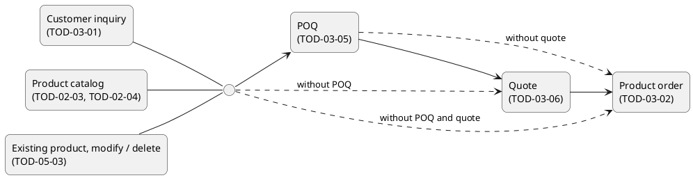
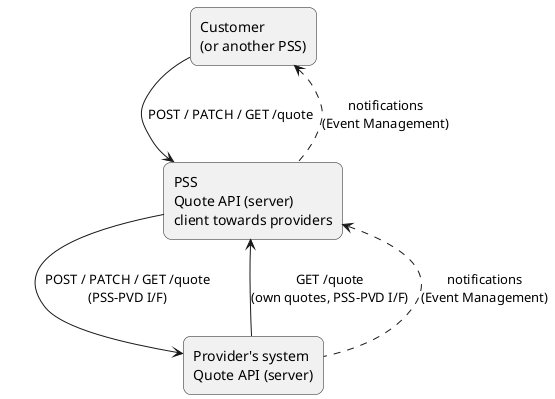
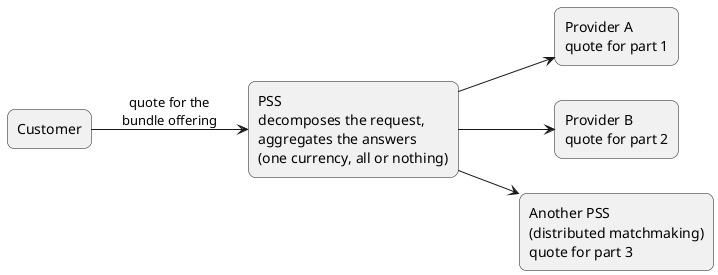
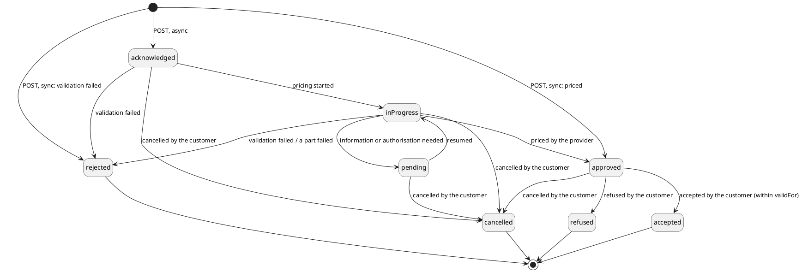
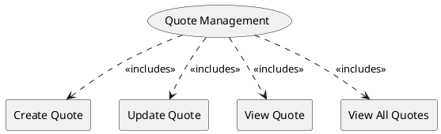

=begin

# TOD-03-06-Quote_Management

> The heading has to be included in the document including this document.

=end

The Quote Management task takes care of the handling of quotes requested by a customer from a PSS and answered by the provider of the quoted product offering.

A quote states the binding price and the terms of one specific, fully configured product offering before it is ordered: the price of each quote item and the total price (one-time and recurring charges), the contract terms (e.g. duration, renewal) and the period for which the quote is valid.
SLA information is not part of the quote itself; it is conveyed by the quoted product offering and the product characteristics.

**Position in the customer journey**

The quote completes the pre-order steps: the customer inquiry (see [TOD-03-01](#tod-03-01-customerinquirymanagement)) finds candidate offerings for a request, the product offering qualification (POQ, see TOD-03-05) confirms that one specific candidate is available and can be delivered, and the quote fixes its final price and terms.

POQ and quote are both optional from the point of view of the interface, each on its own.
A product order (see [TOD-03-02](#tod-03-02-productordermanagement)) refers to the POQ and to the quote where they were done.
The starting point is a customer inquiry, the product catalog (the customer browses the catalog instead of stating requirements) or an existing product that is to be modified or terminated, and any of POQ and quote may be left out.

{#fig:TOD-03-06-Quote_Sequences}

Whether a quote is required before an order is accepted is not defined by the interface; it may be required by the provider, by the governance of the PSS or by the PSS implementer, and it may depend on the product and on the provider's processes.

Who requests the quote is not defined by the interface either.
The customer may request a quote for an offering of its choice, or the PSS may request quotes on its own; which of the two a PSS does is a configuration left to the PSS implementer.

**Roles and interfaces**

The quote endpoints are implemented both by the PSS and by the provider's system:

* The customer, or another PSS, calls the endpoints of the PSS.
* The PSS calls the same endpoints on the provider's system via the PSS-PVD I/F, to forward the quote request and the customer's updates and to retrieve the provider's answer.
  The PSS therefore acts as the server towards the customer and as the client towards the provider.
* The provider informs the PSS about the changes of a quote (e.g. that it has been priced) by notifications via the Event Management API (see [TOD-01-02](#tod-01-02-eventmanagement)), and the PSS informs the customer in the same way.
* As for product orders, a provider can also view quotes in the PSS via the PSS-PVD I/F, but only its own.
  It does not update quotes in the PSS; updating a quote is reserved for the customer.

{#fig:TOD-03-06-Quote_Interfaces}

Every atomic product offering has exactly one provider.
A customer who wants to compare the offerings of several providers requests one quote per offering and selects among them.
The PSS does not choose a provider on behalf of the customer, but its governance may apply rules that filter offerings before the customer sees them.

**Content of a quote request**

A quote is requested for a fully configured product.
If the inquiry left open characteristics that the provider needs to price the product (e.g. the frequency band), the customer sets them before requesting the quote.
If a POQ was done before, the characteristics set in the POQ stay the same in the quote and in the product order; characteristics that the POQ did not set may be added.

The terms of a product (e.g. contract duration, renewal, charge period) are given in its product terms (*productTerm*).
The implementer MAY require equal terms for all quote items.

**Bundles and several providers**

For a bundle offering composed by the PSS from offerings of one or several providers, the PSS decomposes the quote request into one quote request per bundled offering, sends each to its provider (or to another PSS in a distributed matchmaking) and aggregates the answers into one quote for the bundle offering.

{#fig:TOD-03-06-Quote_Decomposition}

* Where POQs were done for the parts of a bundle, the quote can be requested once the POQs of all parts have been completed; it does not follow from them automatically.
  Since the POQ is optional, a quote can also be requested without a POQ before it.
* The PSS unifies the currency: the total price of the quote is given in one currency, also when the providers price their parts in different currencies.
  The choice of the currency and of the exchange rate is left to the PSS implementer.
* The PSS SHOULD unify the terms: the logic of unification is left to the PSS implementer.
* The quote succeeds only as a whole: if one part is rejected or not answered, the whole quote is `rejected`, and the reason names the part that failed.
  A part that its provider cannot offer with the common terms SHOULD fail as well.
  The PSS does not need to cancel the quotes of the other parts at their providers: a quote binds no one until it is accepted, and it can no longer be accepted after its validity period.

The same applies when the customer selects several offerings, from the catalog or from the results of an inquiry, and requests one quote with several quote items: each item is sent to the provider of its offering, and if one item fails, the whole quote fails.

=begin

> Open: whether one quote with items of several offerings is allowed, or only one quote per offering (atomic or bundle).
> CGI confirmed several items for the product order on 2026-10-20, not for the quote.

=end

**Changes to an existing product**

Quotes are also used for changes to an existing product.
A modification (`modify`) or termination (`delete`) of a product from the product inventory does not go through a customer inquiry.
It is a product order with the action `modify` or `delete`, which may be preceded by a POQ, by a quote, or by both; a quote answers e.g. the price of the change or the fee for a termination.

A modification changes the characteristics of the product, within the bounds that its product offering allows, or the product offering itself, e.g. an upgrade to another offering of the same provider.
The product specification and the provider of a product cannot be changed by a modification.
Replacing a product by one of another provider is the termination of the existing product and a new order, usually after a new customer inquiry.

**Synchronous and asynchronous processing**

A quote can be processed synchronously or asynchronously; the client states its expectation with *instantSyncQuote*:

* `true` - The server prices the quote at once and returns it in the response, in the state `approved` or, if it fails the business validation, `rejected`.
* `false` - The server stores the request and returns the quote in the state `acknowledged`; the pricing continues afterwards.
  This is the usual case when the provider needs time or human intervention to price the quote.

In both cases the quote is created and the server answers with `201` and the quote in the response; the state of the quote tells the client which answer it got.
Though *instantSyncQuote* signals the expectation of the client, the server may answer asynchronously when it cannot price the quote at once, and the client has to handle both answers (as for Check Product Stock, see [TOD-05-04-01](#tod-05-04-01-checkproductstock)).
A synchronous answer from the PSS requires that the PSS in turn obtains a synchronous answer from the provider (from each provider of a bundle offering).

For an asynchronous quote, the PSS learns the provider's answer from the provider's notifications, and the customer learns it from the notifications of the PSS (see [TOD-01-02](#tod-01-02-eventmanagement)); both can also view the quote at any time.

The provider states for how long the quote is valid (*validFor*); the customer accepts or refuses the quote within that period, and an accepted quote is referenced by the product order.
After the validity period has ended, the quote stays in the state `approved` but can no longer be accepted; there is no separate state for an expired quote.
A product order cannot be requested with a quote whose validity period has ended, even if the quote was accepted.

**Quote lifecycle**

A quote and each of its quote items go through the following states, which are based on those of TMF648 with these changes:

* `declined` is not used;
* the TMF648 state `rejected`, in which the customer rejects the quote, is renamed to `refused`;
* `rejected` is used for a quote that failed the business validation, as for product orders.

The labels on the transitions name the event and, where only one party may cause it, that party.

{#fig:TOD-03-06-Quote_States}

| State          | Meaning                                                                                                                                                                                                                  | Processing     |
|------------------|--------------------------------------------------------------------|:------------:|
| `acknowledged` | The quote request has been received and stored by the server (PSS or provider), and its identifier has been returned to the client; the quote has not been priced yet. Set by the server (PSS or provider).            | async          |
| `inProgress`   | The quote is being priced; at the PSS this means that it has been forwarded to the provider (to every provider of a decomposed quote). Set by the server (PSS or provider).                                             | async          |
| `pending`      | The provider needs further information or an internal authorisation before it can price the quote. Set by the server (PSS or provider).                                                                                | async          |
| `approved`     | The quote is priced and valid for the period *validFor*; it waits for the customer's decision. Set by the server (PSS or provider); for a decomposed quote, the PSS sets it once all parts are approved. It stays `approved` after *validFor* has ended, but can then no longer be accepted. | sync and async |
| `accepted`     | The customer has accepted the quote within its validity period; it can be referenced by a product order. Set by the customer only.                                                                                      | sync and async |
| `refused`      | The customer refuses the quote, i.e. its price or terms. Set by the customer only.                                                                                                                                      | sync and async |
| `rejected`     | The quote failed the business validation, in the same way as a rejected product order, or a part of a decomposed quote failed; the reason is given in *quoteErrorMessage*. Set by the server (PSS or provider).          | sync and async |
| `cancelled`    | The customer withdrew the quote request before it was accepted or refused, also after it was priced (`approved`). Set by the customer only; the provider cannot cancel a quote, it rejects it.                        | sync and async |

Table: Quote States. {#tbl:quote-states}

`accepted`, `refused`, `rejected` and `cancelled` are final states; a quote in one of them cannot be updated and does not change its state any more.

As for product orders, only the customer cancels: it sets the state to `cancelled` in the PSS, and the PSS forwards the update to the provider.
A provider that cannot or will not price a quote does not cancel it but sets it to `rejected` with the reason in *quoteErrorMessage*.
The PSS cancels quotes at the provider only on behalf of the customer.

**Failure handling**

* A quote request that does not conform to the PSID648 schema is refused with `400`, and no quote is stored.
* A quote request that fails a business validation which the server can carry out at once (e.g. an unknown product offering) is refused with `422`, and no quote is stored.
* A quote request that conflicts with an existing quote (e.g. a quote with the same identifier already exists) is refused with `409`, and no quote is stored.
* An error that is found only later, during the pricing (in particular by the provider), ends the quote in the state `rejected` with the reason in *quoteErrorMessage*, which names the failed quote items; it reaches the client in a notification and when the quote is viewed.
  In a synchronous quote both kinds of errors are found during the request.
  Business validation failures are e.g.:
  * an unknown or not accessible product offering,
  * a characteristic outside the bounds of the product specification or offering,
  * an item with action `modify` or `delete` without a reference to the existing product,
  * an item with action `modify` that changes the product specification or the provider,
  * characteristics that differ from the referenced POQ,
  * a part or item that its provider cannot offer with the common terms,
  * an offering that no provider of the PSS delivers (then no call reaches a provider).
* If a part of a decomposed quote fails, the whole quote is `rejected`.
* An update that the current state of the quote does not allow, including any update of a quote in a final state and the acceptance of a quote whose validity period has ended, is refused with `409` and leaves the quote unchanged.

The PSS and the provider answer the quote operations with the following codes; a refused request carries an error with a code and the reason.

| Code  | Operations             | Meaning                                                                                                   |
|-------|------------------------|-----------------------------------------------------------------------------------------------------------|
| `201` | Create                 | The quote is created; it is returned in the state `acknowledged`, `approved` or `rejected`.              |
| `200` | Update, View, View All | The quote is updated, or the quote or a page of quotes is returned.                                      |
| `202` | Update                 | The update is accepted and processed afterwards; its result reaches the client in a notification.       |
| `400` | All                    | The request does not conform to the PSID648 schema, or a parameter is invalid; nothing is stored or changed. |
| `401` | All                    | The client is not authenticated.                                                                          |
| `403` | All                    | The client is not allowed to carry out the operation, e.g. on a quote of another customer.               |
| `404` | Update, View           | There is no quote with the given identifier that the client can read.                                    |
| `409` | Create, Update         | Create: a quote with the same identifier already exists, and no quote is stored. Update: the current state of the quote does not allow the update; the quote is unchanged. |
| `422` | Create, Update         | The request fails a business validation that the server carries out at once (e.g. an unknown product offering, or a characteristic outside the bounds of the offering); nothing is stored or changed. |
| `500` | All                    | An error of the server; the client can retry later.                                                       |
| `503` | All                    | The server is temporarily unavailable; the client can retry later.                                       |

Table: Quote Response Codes. {#tbl:quote-response-codes}

**Observability**

The correlation identifier relates all requests, events and log entries that belong to one business transaction across the systems involved: the customer, the PSS and the providers.
It allows a quote to be traced from the request of the customer to every provider that priced it; for a decomposed quote, it relates every provider's quote to the quote of the bundle offering, so that the part that failed can be found.

TMF Open APIs define *correlationId* only in the structure of events.
PSI extends its use to the synchronous REST communication and to logging, without changing the TMF resource models.

* REST communication:
  * The correlation identifier MUST be passed in the HTTP header `X-Correlation-ID`.
  * If a request carries the header, the server MUST use the received value.
    If it does not, the component that receives the request first (e.g. the PSS for a request of the customer) MUST generate a new value (UUID version 4).
  * The server SHOULD return the same value in the header of its response, also when the request is refused.
  * The PSS MUST pass the value on in its requests to the providers.
  * The correlation identifier MUST NOT be added to the body of the TMF resources.
* Events: an event published as a result of processing a request or another event MUST carry in *correlationId* the value of the request or event that caused it.
* Logging:
  * Each log entry related to the processing of a request or an event MUST contain the correlation identifier.
  * Logs MUST be structured (JSON), with the correlation identifier in a field of its own, not in the text of the message.
  * For calls to external systems, the identifier of the TMF resource (*id*, *externalId*) SHOULD be logged as well.

**Operations and endpoints**

{#fig:TOD-03-06-Quote_Management}

Each endpoint is implemented both by the PSS and by the provider's system.
The two last columns state who calls the endpoint on each of them; another PSS calls the PSS in the role of a customer.
Besides these calls, the provider informs the PSS about changes of its quotes by notifications.

| Operation           | Endpoint                                 | Called on the PSS by                             | Called on the provider by      |
|--------------|----------------------------------------------------|--------------------|--------------|
| **Create Quote**    | `POST /quoteManagement/v2/quote`         | customer, another PSS                            | PSS                            |
| **Update Quote**    | `PATCH /quoteManagement/v2/quote/{id}`   | customer, another PSS                            | PSS, on behalf of the customer |
| **View Quote**      | `GET /quoteManagement/v2/quote/{id}`     | customer, another PSS, provider (its own quotes) | PSS                            |
| **View All Quotes** | `GET /quoteManagement/v2/quote`          | customer, another PSS, provider (its own quotes) | PSS                            |

Table: Quote Management Endpoints. {#tbl:quote-management-endpoints}

**eTOM Reference**

The task is based on the Develop Sales Proposal and Negotiate Sales/Contract processes of Selling in the Customer domain from the eTOM.
